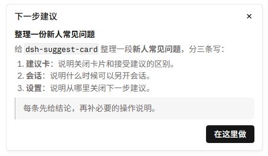
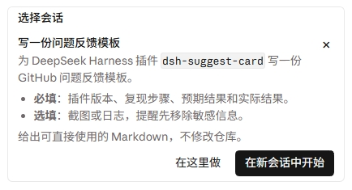

# 下一步建议 · dsh-suggest-card

[](https://www.npmjs.com/package/@k99k5/dsh-suggest-card) · [DeepSeek Harness](https://github.com/deepseek-ai/deepseek-harness)

**在当前会话用快捷按钮回答追问，或点击卡片接受下一步建议。** 建议卡片的交互类似 Claude Code Desktop 的「下一步建议」。只有需要决定任务在哪个会话执行时，才显示「在新会话中开始」。默认不额外调用模型。

## 界面预览





## 安装

在 DeepSeek Harness 的插件管理中添加 `@k99k5/dsh-suggest-card`。使用本地源码时，先按下方「开发」步骤构建，再添加本地包目录；已打包的版本不需要重新构建。插件以 Desktop 0.2.2-rc.5 的服务与插槽为目标。

## 试一试

| 发给助手 | 回复结束后可以做什么 |
| --- | --- |
| 「建议一项独立的文档改进，用任务卡展示，先不要执行。」 | **下一步建议**只提供 **在这里做**，点击后将任务标题和说明发送到当前会话；点 **×** 忽略。 |
| 「帮我整理 README，开始前用卡片让我选择在哪个会话做。」 | **选择会话**提供 **在这里做** 和 **在新会话中开始**。后者在同一工作区用默认预设新建会话，只发送卡片标题和说明，不复制对话历史或附件。未分组时使用原目录。 |
| 「请在最后单独问我：你希望导出 PDF，还是导出 CSV？」 | 默认模式下，点 **导出 CSV** 就会向当前会话发送「导出 CSV」。本地规则识别常见中英文二选一和确认句，不会把任意问号都变成按钮。 |

阅读正文或关闭卡片不会执行任务，点击发送也不会覆盖输入框里的草稿。助手主动提议任务卡需要会话预设允许 `offer_task_card`。每个正常结束的回合最多显示一种操作；新一轮开始，旧操作消失。

任务标题支持行内代码、粗体和斜体；说明还支持列表、引用和代码块。链接、图片地址和 HTML 保留为文字，不会自动访问外部资源。“在这里做”和“在新会话中开始”发送的都是卡片的 Markdown 原文。

## 设置与隐私

打开 **设置 → 下一步建议**。关闭总开关后，插件不再显示卡片或发起检查。设置会自动保存；保存失败时会提示，并恢复到已保存的值。

- **不选检查模型（默认）**：末行可识别的普通确认或二选一优先显示快捷回复，不会被独立任务建议盖住。如果问的是执行位置，而且助手已提供对应的会话选择卡，则显示真正的会话操作。开放问题、引用、代码块和未完成的回合不会产生本地问题按钮。
- **选择检查模型**：普通用户对话正常结束后，插件仍将本轮用户文字和最终回复发给所选模型，长文本只保留首尾，不附带历史、附件、工具结果或思考过程。已识别的普通追问直接显示快捷回复，不等待模型；没有本地卡片时可以显示模型建议。只有执行位置待选时才推荐选择会话。正文可能含敏感信息，调用费用取决于所选账号。
- **保存范围**：浏览器标签页只记录关闭和发送状态，不保存任务正文，不同窗口不共享点击状态。宿主只在内存中保留最近 256 次模型检查结果；重启后不恢复，刷新或浏览历史也不会补跑。

## 开发

```sh
npm ci --ignore-scripts
npm run build
npm test
npm pack --dry-run --ignore-scripts
```

最后一条命令只列出打包内容，不会发布到 npm。

## 发布到 npm

普通 Git 推送、草稿和预发布不会发布 npm 包。发布新的正式版本时，GitHub Release 标签必须是 `v` 加包版本，例如 `v0.0.1`。[发布工作流](.github/workflows/release.yml) 校验包名和版本、构建、测试、打包，然后用 GitHub OIDC **直接发布**该包，并附上来源证明（provenance）。已发布的正式 Release 可以从 `main` 手动重试。

前提是 npm 包已将 `k99k5/dsh-suggest-card` 的 `release.yml` 配为 [Trusted Publisher](https://docs.npmjs.com/trusted-publishers/)，并允许 `npm publish`。工作流不需要长期 npm 令牌，也不经过暂存审批。

## 许可证

本项目采用 GNU 宽通用公共许可证第 3 版（`LGPL-3.0-only`，仅限此版本）。完整条款见 [LGPLv3](./COPYING.LESSER) 及其引用的 [GPLv3](./COPYING)。
